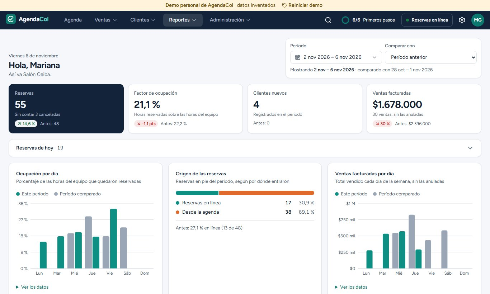
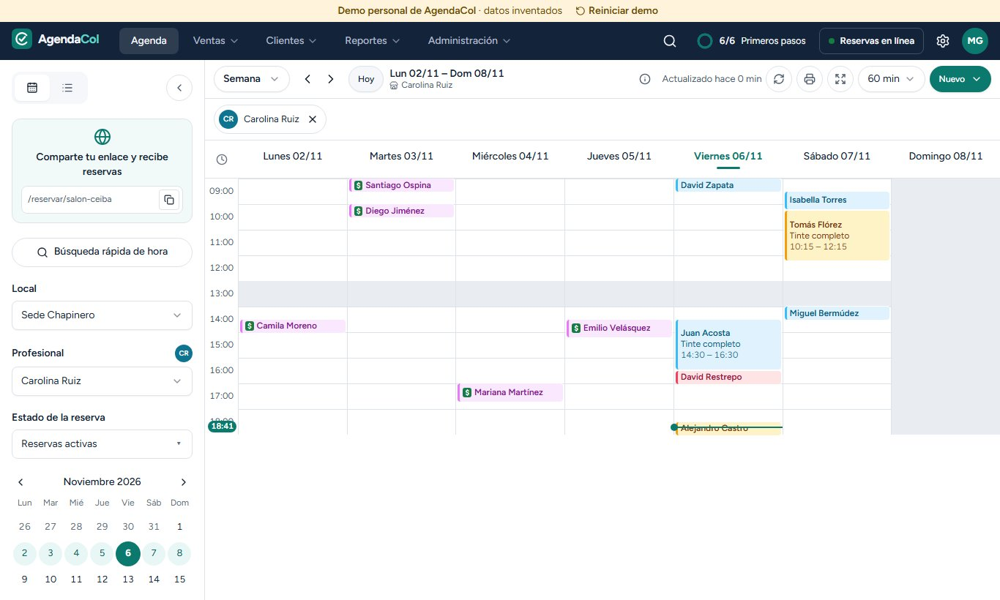
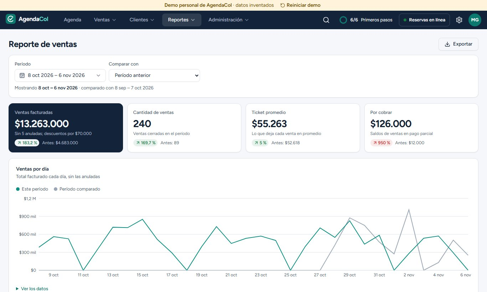
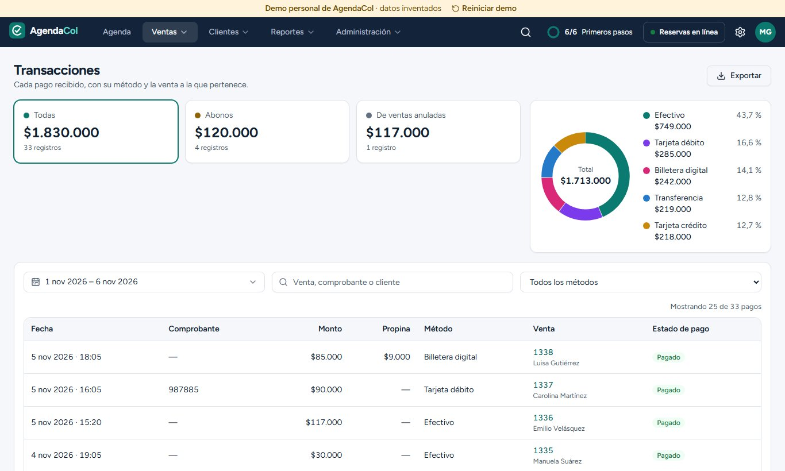
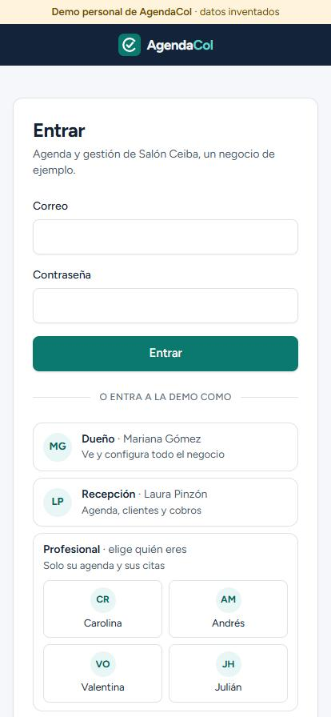
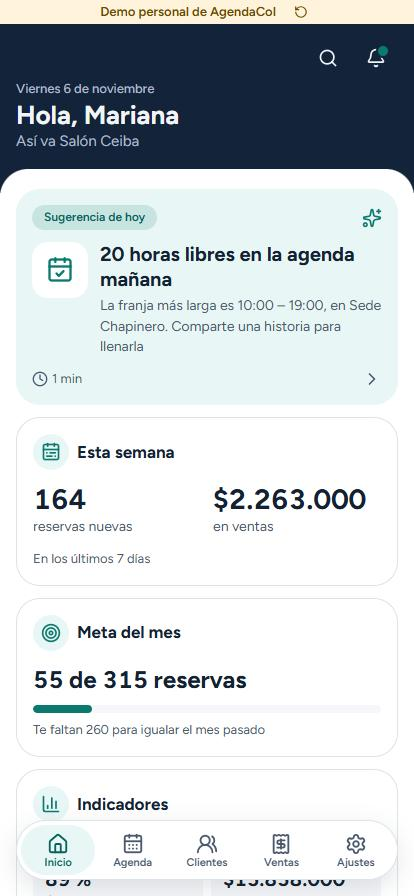
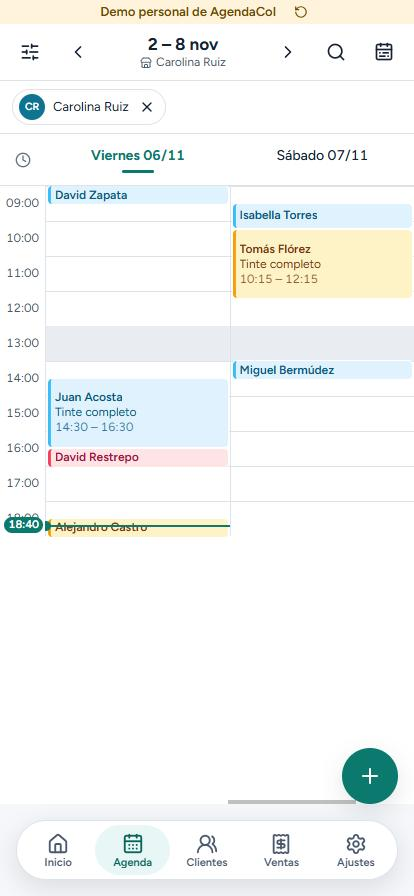
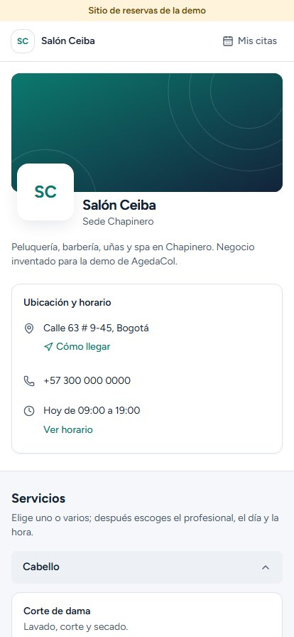

# AgendaCol

**Demo de agenda y gestión para salones y barberías**: agenda del equipo, reservas en línea, ventas y caja,
clientes, marketing y reportes, en una sola app web que funciona igual en el computador de la recepción y en el
celular del dueño.

**Demo en línea:** https://agedacol.vercel.app · entra con un clic como Dueño, Recepción o Profesional.

> Todo es inventado: **Salón Ceiba** es un negocio de ejemplo y sus clientes, citas y ventas son datos ficticios.
> Los correos y mensajes que la app "enviaría" llegan al **Buzón de la demo**; nada sale de la app.

<p>
  
  
  
  
</p>
<p>
  
  
  
  
</p>

## Qué problema resuelve

Un salón con varios profesionales y sedes necesita saber en todo momento quién está libre, cobrar sin errores,
cuadrar la caja y traer de vuelta a los clientes. AgendaCol reúne todo eso: la recepción agenda y cobra, cada
profesional ve solo su agenda y sus cobros, el dueño ve los números del negocio y los clientes reservan solos desde
el sitio del salón.

## Funcionalidades

- **Agenda** por día, 3 días, semana, mes y lista; por sede y por profesional; bloqueos, horarios, recursos (sillas,
  cabinas) y cambios en tiempo real entre varias pantallas abiertas.
- **Reservas en línea:** sitio público del salón (`/reservar/[slug]`) con servicios, profesional, hora y "Mis citas"
  para que el cliente cambie o cancele.
- **Ventas:** cobro de citas y productos, propinas, pagos parciales (abonos), varios métodos de pago, numeración de
  ventas, comprobantes, caja con ingresos, egresos, traspasos y cuadre de efectivo, gift cards y planes.
- **Clientes:** base con filtros avanzados, importación y exportación, ficha con historial, fidelización y lista de
  espera.
- **Marketing:** correo masivo, recordatorios automáticos, plantillas de WhatsApp y sugerencias para llenar la
  agenda.
- **Reportes:** resumen con ocupación, origen de las reservas y ventas por día; reportes de reservas y de ventas con
  comparación contra el periodo anterior.
- **Administración:** sedes, servicios, profesionales, productos e inventario, precios dinámicos, usuarios y
  permisos por rol (Dueño, Recepción, Profesional).
- **PWA:** se instala en el celular, navegación de una mano con áreas táctiles de 44 px, modo día y noche, aviso sin
  conexión.

## Stack

| Capa           | Tecnología                                                                  |
| -------------- | --------------------------------------------------------------------------- |
| Frontend       | Next.js 16 (App Router, Server Actions), React 19, TypeScript               |
| UI             | Tailwind CSS 3.4, shadcn/ui (Radix), dnd-kit, React Hook Form               |
| Backend        | Supabase: PostgreSQL, Auth, Row Level Security, Realtime, funciones SQL     |
| Validación     | Zod                                                                          |
| Pruebas        | Vitest (unitarias e integración contra la base) y Playwright (E2E)          |
| Despliegue     | Vercel + Supabase en la nube                                                |

Arquitectura *feature-first* (`src/features/agenda`, `ventas`, `clientes`, `reportes`, `reserva-publica`…). Los
permisos se aplican dos veces: en la interfaz por rol y en la base con políticas RLS, que son las que mandan. Las
reglas delicadas (que dos citas no se crucen, la numeración de ventas, el cuadre de caja) están en funciones y
restricciones de PostgreSQL.

```
src/
├── app/           # (app)/* panel del negocio, (publico)/reservar/[slug] sitio de reservas, entrar
├── features/      # agenda, citas, ventas, clientes, marketing, reportes, administracion, reserva-publica…
├── shared/        # Componentes, permisos, red, fechas y dinero
└── types/         # Tipos generados de la base
supabase/          # 20 migraciones SQL (esquema, RLS, funciones) y semilla con datos ficticios
tests/             # integracion/ (contra Supabase local) y e2e/ (Playwright)
scripts/           # usuarios de demo, imágenes de arranque, capturas de antes y después
```

## Pruebas

| Tipo                                     | Cantidad | Cómo se corren                            |
| ---------------------------------------- | -------- | ----------------------------------------- |
| Unitarias (reglas puras)                 | 195      | `npx vitest run src`                      |
| Integración contra la base (RLS, SQL)    | ~105     | `npm test` (con Supabase local)           |
| E2E con Playwright                       | ~185     | `npm run test:e2e` (con Supabase local)   |

## Correrlo en local

Requisitos: Node.js 20 o más nuevo, Docker (para el Supabase local) y npm.

```bash
npm install
cp .env.example .env.local
npm run db:start     # Supabase local en Docker; imprime la URL, la llave anon y la service_role
# pega esas llaves en .env.local y elige una DEMO_PASSWORD
npm run db:reset     # migraciones + semilla + usuarios de demo
npm run dev          # http://localhost:3010
```

Para un Supabase en la nube: crea un proyecto, enlázalo con `npx supabase link --project-ref <tu-ref>`, aplica las
migraciones y la semilla con `npx supabase db push --include-seed`, crea los usuarios de demo con
`DEMO_PROYECTO_NUBE=https://<tu-ref>.supabase.co node --env-file=.env.local scripts/usuarios-demo.mjs --nube` y pon las mismas variables de `.env.example` en `.env.local`
o en Vercel.

Otros comandos: `npm run build`, `npm run lint`, `npm run typecheck`, `npm run demo:casa` (sirve la demo a los
celulares de la red local).

## Cómo se construyó

Desarrollo asistido por IA con **Claude Code** como motor principal de código. Antes de programar se escribieron
los requisitos del producto (PRD), la especificación técnica, las historias de usuario con criterios de aceptación y
un plan por fases; cada fase se construyó con agentes de IA en paralelo y pasó compuertas de calidad (lint, tipos,
pruebas unitarias, de integración y E2E, y auditorías de seguridad y de diseño) antes de cerrarse. Yo definí los
requisitos, tomé las decisiones de producto y arquitectura, revisé el código, probé la app y la publiqué.

---

Hecho por **Daiver Marmolejo Correa** · Desarrollador Full Stack con IA · [github.com/daivermco-code](https://github.com/daivermco-code)
